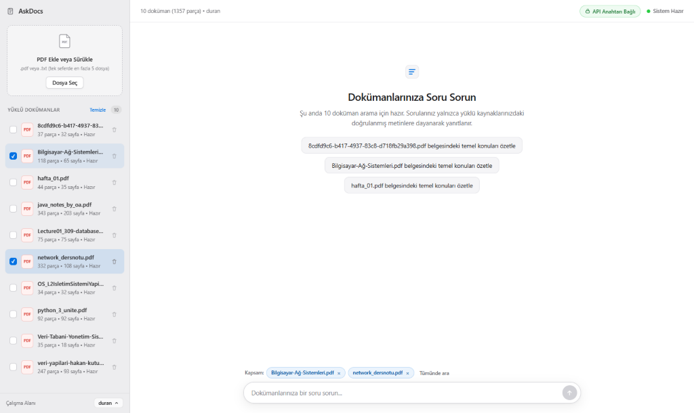
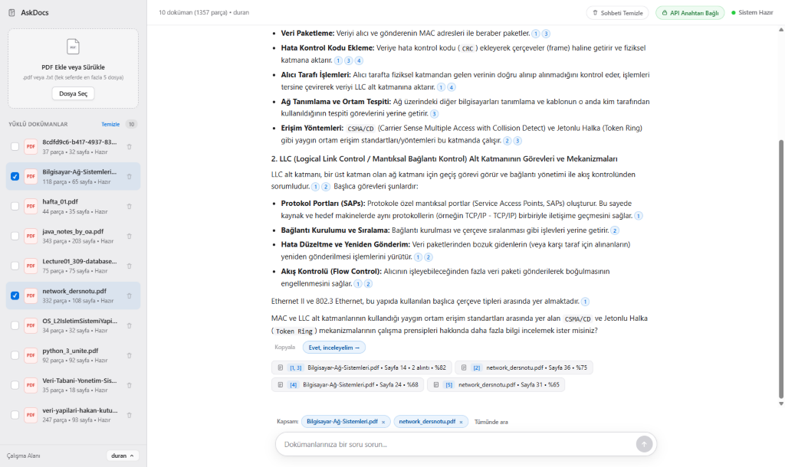
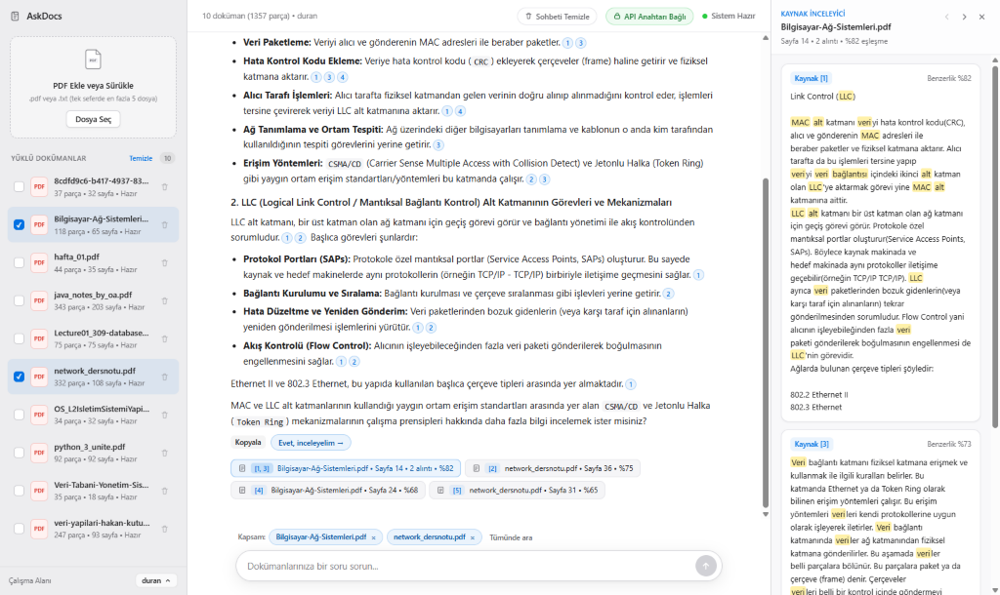
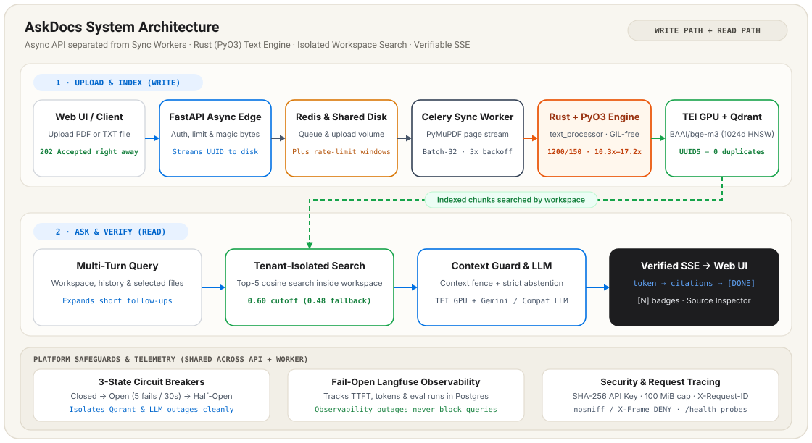
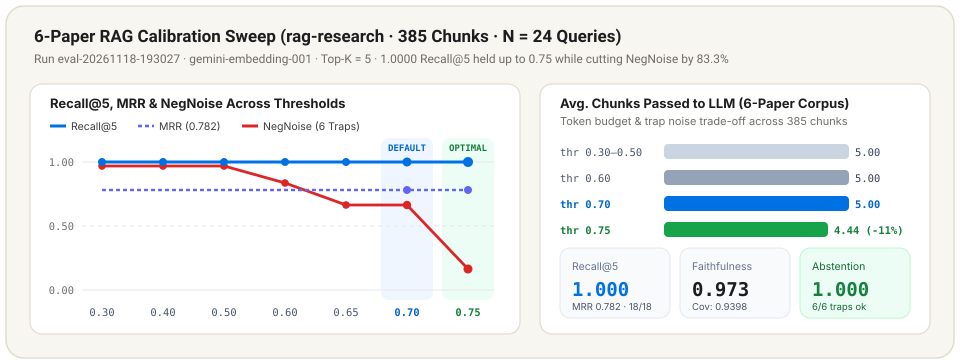

<div align="center">

<br />


<br />
<br />

**Upload your documents into isolated workspaces, ask questions in natural language, and verify every answer down to the exact source page.**

<p>
  <a href="#why-askdocs">Why AskDocs</a> ·
  <a href="#see-it-in-action">See it in action</a> ·
  <a href="#architecture--tech-stack">Architecture</a> ·
  <a href="#engineering-decisions">Design Choices</a> ·
  <a href="#benchmarks--evaluations">Benchmarks</a> ·
  <a href="#quickstart">Quickstart</a> ·
  <a href="#api-reference">API</a> ·
  <a href="README.tr.md">Türkçe</a>
</p>

<p>
  <sub>
    <code>Python 3.11+</code> ·
    <code>Rust (PyO3)</code> ·
    <code>FastAPI</code> ·
    <code>Celery &amp; Redis</code> ·
    <code>Qdrant</code> ·
    <code>Gemini + Local TEI (BAAI/bge-m3)</code> ·
    <code>Langfuse</code> ·
    <code>179 Tests (173 Py + 6 Rust)</code> ·
    <code>87.7% Branch Cov</code>
  </sub>
</p>

</div>

---

## Why AskDocs?

Turning documents into a reliable Q&A workspace takes more than dropping a vector store behind a chat box. When a user uploads a heavy PDF, the web server cannot afford to freeze while extracting pages and calling embedding APIs. Different teams need strict workspace isolation, retries should never multiply duplicate vectors, and every generated claim needs a clear trail back to its exact source page.

**AskDocs** was built from scratch without heavy framework wrappers so every stage—from streaming uploads to background indexing, retrieval scoping, and verified token streaming—stays fast, observable, and predictable.

### Core Capabilities

* **Isolated Workspaces & File Scoping:** Separate documents and queries cleanly per tenant workspace, or check individual PDFs in the sidebar to restrict search strictly to selected files.
* **Non-Blocking Ingestion:** Uploads validate file integrity immediately, return `202 Accepted`, and hand parsing, chunking, and batched embedding work off to background Celery workers.
* **Verified Citations & Source Inspector:** Answers stream live with clickable `[1]`, `[2]` badges that slide open a Source Inspector pointed at the matched page, similarity score, and highlighted passage.
* **Bilingual Follow-Ups & Guardrails:** Expands short follow-up replies cleanly from chat context, isolates prompt-extraction attempts and `<context>` injection tags, suppresses unrelated citation cards on refusals, and abstains cleanly when evidence is missing.
* **Production Resilience & Hybrid Model Portability:** Dual async/sync circuit breakers isolate vector or LLM outages, Redis rate limiting and Langfuse tracing fail open, `EMBEDDING_BASE_URL` decouples local GPU embeddings (`BAAI/bge-m3` via HuggingFace TEI) from cloud chat generation (`gemini-3.5-flash-lite`), and Qdrant automatically recreates collections on vector dimension changes.

---

## See it in action

Below is a three-step walkthrough inside the isolated **`duran`** workspace loaded with **10 university computer science PDFs (`753` indexed pages, `1,357` chunks)** spanning Computer Networks, Databases, Operating Systems, Python, Java OOP, Data Structures, and AI Literacy.

### `#1` / Select a Workspace & Scope Specific Documents

Switch workspaces at the bottom left, drag and drop multiple PDFs or text files, and check specific textbooks (`Bilgisayar-Ağ-Sistemleri.pdf` and `network_dersnotu.pdf`) to lock retrieval solely to those two networking sources.

<div align="center">
  
</div>

### `#2` / Stream Grounded Markdown & Inline Citations

Ask a detailed technical question across the two scoped networking textbooks and watch structured Markdown stream word-by-word with clickable `[1]`, `[2]`, `[3]`, `[4]` citation pills, a clean copy button that strips citation markers, contextual follow-up actions (`Evet, inceleyelim →`), and per-page relevance badges (`%82`, `%75`, `%68`, `%65`) across both PDFs.

<div align="center">
  
</div>

### `#3` / Verify Claims in the Source Inspector

Click citation `[1, 3]` to slide out the Cupertino Source Inspector right to **page 14 of `Bilgisayar-Ağ-Sistemleri.pdf`** (`2` quotes, **`82%`** & **`73%`** similarity match) with yellow-highlighted key terms (`LLC`, `MAC`, `veri`, `bağlantısı`, `alt`) so every claim can be verified in seconds.

<div align="center">
  
</div>

---

## Architecture & Tech Stack

<div align="center">
  
</div>

AskDocs strictly separates heavy document ingestion (**Write Path**) from low-latency conversational streaming (**Read Path**):

* **1. Upload & Index (Write Path):**
  `PDF Upload` → `FastAPI (202 Accepted)` → `Celery Worker` → `PyMuPDF + Rust Chunking` → `Local TEI GPU (BAAI/bge-m3)` → `Qdrant (1024-dim)`
  Large PDF uploads never stall the API: FastAPI validates the request and hands off work immediately. Workers stream pages incrementally, clean and split text (`1200` chars / `150` overlap) via the **Rust (`PyO3`)** engine, generate quota-free `1024`-dim vectors on the local GPU **HuggingFace TEI** server (`98.8 chunks/s` across all `1,357` chunks), and index deduplicated points into Qdrant.

* **2. Ask & Verify (Read Path):**
  `Question` → `Local TEI Embedding` → `Qdrant Similarity Search` → `Security & Context Filter` → `SSE Stream + Citation Cards`
  Short follow-ups and document-title continuity resolve against prior conversation context, TEI embeds queries locally (`p50 = 17.9 ms`), and Qdrant retrieves the top 5 matching chunks (`0.60` primary / `0.48` fallback cutoff) from the active workspace. Missing evidence and prompt-extraction attempts trigger honest abstention with zero leaked citations; grounded answers stream word-by-word from the Chat LLM with clickable `[1]`, `[2]` source badges.

### Stack Breakdown

| Layer | Choice | Why It Is Here |
| :--- | :--- | :--- |
| **API & Web UI** | FastAPI + Vanilla JS | Async REST/SSE delivery, SHA-256 API-Key auth, and a zero-framework Cupertino UI |
| **Queue & Workers** | Celery + Redis | Isolates CPU/network indexing bursts from FastAPI and tracks sliding-window rate limits |
| **PDF & Text Core** | PyMuPDF + Rust (`PyO3`) | Incremental page streaming plus a native, GIL-free Rust text cleaner and chunker |
| **Vector Store** | Qdrant | Tenant-isolated HNSW search, document scoping, auto dimension sync, and idempotent upserts |
| **Embeddings (Local GPU)** | HuggingFace TEI (`BAAI/bge-m3`) | Zero-quota `float16` CUDA inference (`1024`-dim, `8192`-token context, `corerag-tei`) |
| **Chat LLM (Cloud / Compat)** | Gemini (`gemini-3.5-flash-lite`) | Connection-pooled OpenAI-compatible SSE streaming (`LLM_BASE_URL`, swappable via `.env`) |
| **Telemetry** | Langfuse + PostgreSQL | Fail-open traces for retrieval scores, TTFT latency, and evaluation runs |

---

## Engineering Decisions

| Problem | Solution | Practical Impact |
| :--- | :--- | :--- |
| **Cloud embedding rate limits throttling PDF ingestion** | Decoupled `EMBEDDING_BASE_URL` to local GPU **HuggingFace TEI (`BAAI/bge-m3`)** while keeping Chat on `LLM_BASE_URL` | **Zero `429` embedding limits**, `p50=17.9 ms` query embeddings, **`13.7 s`** full indexing of all 10 PDFs (`1,357` chunks @ `98.8 chunks/s` on RTX 3050 Ti), and **3x** smaller Qdrant vectors (`1024` vs `3072`) |
| **Large PDFs blocking Python & CPU cores** | Rewrote text normalization and chunking in native **Rust (`PyO3`)** | **17.2x** faster cleaning, **10.3x** faster chunking, and **3.7x** lower Python RAM |
| **API freezing during file uploads** | Kept FastAPI purely async; offloaded indexing to Celery workers | Instant `202 Accepted` uploads; zero impact on concurrent chat latency (`p50=14.0 ms`) |
| **Orphan files or duplicate vectors on retry** | Compensating disk cleanup (`rollback`) and deterministic `UUID5` point IDs | Zero leaked temporary files and zero duplicate chunks across retries |
| **One tenant or outage stalling everyone** | Three-state **Circuit Breakers** and atomic Redis rate limiting (`fail-open`) | Fast `503` protection on outages; Redis or Langfuse downtime never stops search |
| **LLM hallucination or prompt injection** | Calibrated `0.60`/`0.48` cutoffs, `<context>` sanitization, prompt-extraction guards, and `[DONE]` stream checks | **100%** trap-question abstention with **`0` trap noise** at `0.60`; truncated streams never pollute chat history |

---

## Benchmarks & Evaluations

All metrics below are measured directly from reproducible evaluation, GPU throughput, CPU/memory comparison, and load-test harnesses in this repository using the **`duran` 10-PDF workspace (`753` indexed pages, `1,357` chunks)**.

### 1. RAG Accuracy & Hallucination Benchmark (`duran` · 10 PDFs · 1,357 Chunks)

To stress-test multi-document disambiguation across overlapping university textbooks (two networking PDFs, two database PDFs, two Python PDFs, plus Java, OS, Data Structures, and AI Literacy), AskDocs is evaluated inside the **`duran`** workspace using **30 bilingual questions** (`24` answerable Turkish/English queries across all 10 PDFs + `6` unanswerable & near-miss adversarial trap questions):

| Metric | Result | What It Means |
| :--- | :---: | :--- |
| **Source Retrieval (`Recall@5`)** | **`1.0000`** (`24 / 24`) | Every answerable query surfaced the exact expected PDF & page inside Top-5 across 1,357 chunks |
| **First-Rank Precision (`MRR`)** | **`0.9097`** | Ground-truth passages ranked first (`1.000`) on 20/24 queries despite heavy topic overlap |
| **Grounded Faithfulness** | **`0.9867`** | Inline `[Source N]` citations mapped cleanly to retrieved pages with zero fabricated references |
| **Keyword Coverage** | **`0.9722`** | `97.2%` of expected technical terms and figures appeared accurately in TR & EN answers |
| **Trap Rejection (`Abstention`)** | **`1.0000`** (`6 / 6`) | All 6 out-of-scope and adversarial near-miss traps were cleanly declined without hallucination |

<div align="center">
  
</div>

<details>
<summary><strong>Open similarity threshold (0.30–0.70) calibration table (duran · 10 PDFs)</strong></summary>

Run: `eval-20261120-203718` · Workspace: `duran` (`10` PDFs / `753` pages / `1,357` chunks) · `gemini-3.5-flash-lite` + `BAAI/bge-m3` · [`evals/latest_eval_report.json`](evals/latest_eval_report.json)

| Score Threshold | `Recall@5` | `MRR` | Avg Chunks | Trap Noise (`NegNoise`) |
| :---: | :---: | :---: | :---: | :---: |
| `0.30` | `1.0000` | `0.9097` | `5.00` | `1.0000` |
| `0.40` | `1.0000` | `0.9097` | `5.00` | `0.8333` |
| `0.48` (Fallback Cutoff) | `1.0000` | `0.9097` | `5.00` | `0.6667` |
| `0.55` | `1.0000` | `0.9097` | `4.62` (`-7.6%`) | `0.1667` |
| **`0.60` (Production / Recommended)** | **`1.0000`** | **`0.9097`** | **`3.29` (-34.2%)** | **`0.0000` (-100.0%)** |
| `0.65` | `0.7917` | `0.7708` | `1.58` | `0.0000` |
| `0.70` | `0.6250` | `0.6042` | `0.92` | `0.0000` |

`0.60` sits right on the Pareto knee for `BAAI/bge-m3`: it eliminates **100% of trap-query noise (`0.0000`)** and trims LLM context token load by **34.2%** (`5.00` → `3.29` chunks) while keeping `Recall@5` (`1.0000`) and `MRR` (`0.9097`) intact; raising the cutoff to `0.65` drops `Recall@5` sharply to `0.7917`.

</details>

### 2. What Rust (`PyO3`) Unlocked (50 MiB Text Microbenchmark)

Comparing pure Python against the compiled Rust engine ([`evals/text_processor_benchmark.json`](evals/text_processor_benchmark.json)) on an isolated 50.00 MiB (`49,585,446` chars) noisy text corpus with zero network or GPU latency:

| Operation | Pure Python | Rust (`PyO3` v0.1.0) | Gain |
| :--- | :---: | :---: | :--- |
| **Text Cleaning (`clean_text`)** | `4.40 s` (`11.36 MiB/s`) | **`0.26 s` (`195.83 MiB/s`)** | **17.23x faster** |
| **Text Chunking (`chunk_text` · 69,349 chunks)** | `4.34 s` (`11.53 MiB/s`) | **`0.42 s` (`118.87 MiB/s`)** | **10.31x faster** |
| **Chunking Memory Peak (Python Heap)** | `749.51 MiB` | **`202.12 MiB`** | **3.71x less RAM** |

* **Why such a large jump?** Python allocates hundreds of megabytes of transient Unicode copies across chained regex passes while holding the GIL.
* **Zero Lock Contention, Exact Parity:** Rust scans linearly outside the Python heap without holding the GIL, producing **100% character-identical chunks** to Python.
* **Zero Runtime Bloat:** Built in multi-stage Docker so no Rust compiler ships to production, with automatic fallback to pure Python if the compiled wheel is absent.

### 3. Load Test, Local TEI GPU & PDF Stream Throughput

30-second Locust concurrency run with 20 virtual users (with mock AI isolating orchestration overhead), live GPU TEI throughput on the `10`-PDF `duran` corpus, and PyMuPDF page-streaming speed:

| Benchmark | Workload | Result | Takeaway |
| :--- | :--- | :--- | :--- |
| **Locust Load Mix** | 8 endpoints, `1,297` requests | **`44.45 RPS` · 0.0% errors** | `p50=14.0 ms`, `p95=130.0 ms`, `p99=170.0 ms` |
| **Container Memory** | 4 core services (`docker stats`) | **Peak `162.5 MiB` API / `286.5 MiB` Worker** | `0` OOMs and `0` restarts (`782.9 MiB` TEI GPU service) |
| **Local TEI Query Embed** | 30 `BAAI/bge-m3` single queries | **`p50=17.90 ms` (`p95=21.03 ms`)** | Zero cloud latency or API rate limits |
| **Local TEI Bulk Embed** | All 10 `duran` PDFs (`1,357` chunks) | **`13.73 s` (`98.8 chunks/s`)** | Full 753-page corpus re-embedded in 13.7 s (`batch=32`) |
| **PyMuPDF PDF Stream** | 100-page PDF from `duran` text | **`37.04 ms` (`2,700 pages/s`)** | 5-run median throughput via `iter_document_pages` |
| **Smart Chunk Size (`1200/150`)** | Real `duran` 10-PDF text (`1.14 MB`) | **`1,027` chunks** | **`2.59x` fewer** embeddings vs `500/75` (`2,658`) |

<details>
<summary><strong>Per-endpoint Locust breakdown &amp; Docker container RAM table</strong></summary>

Full report: [`evals/load_test_report.json`](evals/load_test_report.json)

| Endpoint | Requests | Failures | RPS | `p50` | `p95` | `p99` |
| :--- | :---: | :---: | :---: | :---: | :---: | :---: |
| `GET /api/v1/health` | `130` | `0.0%` | `4.46` | `10.0 ms` | `28.0 ms` | `62.0 ms` |
| `POST /api/v1/documents/upload` | `77` | `0.0%` | `2.64` | `52.0 ms` | `76.0 ms` | `92.0 ms` |
| `GET /api/v1/documents/status/{task_id}` | `154` | `0.0%` | `5.28` | `6.0 ms` | `19.0 ms` | `34.0 ms` |
| `GET /api/v1/documents` | `267` | `0.0%` | `9.15` | `9.0 ms` | `20.0 ms` | `37.0 ms` |
| `GET /api/v1/documents/tenants` | `131` | `0.0%` | `4.49` | `8.0 ms` | `24.0 ms` | `59.0 ms` |
| `POST /api/v1/query` | `286` | `0.0%` | `9.80` | `110.0 ms` | `170.0 ms` | `190.0 ms` |
| `POST /api/v1/query/stream` | `175` | `0.0%` | `6.00` | `64.0 ms` | `120.0 ms` | `140.0 ms` |
| `DELETE /api/v1/documents/{document_id}` | `77` | `0.0%` | `2.64` | `9.0 ms` | `23.0 ms` | `29.0 ms` |

| Container | Start RAM | Peak RAM | End RAM | Max CPU | OOM / Restarts |
| :--- | :---: | :---: | :---: | :---: | :---: |
| `corerag-api` | `160.70 MiB` | **`162.50 MiB`** | `161.10 MiB` | `37.03%` | `0 / 0` |
| `corerag-worker` | `226.70 MiB` | **`286.50 MiB`** | `282.00 MiB` | `26.69%` | `0 / 0` |
| `corerag-qdrant` | `147.90 MiB` | **`150.90 MiB`** | `131.80 MiB` | `7.32%` | `0 / 0` |
| `corerag-redis` | `10.18 MiB` | **`12.48 MiB`** | `12.36 MiB` | `1.69%` | `0 / 0` |

</details>

---

## Quickstart

### 1. Clone & Configure `.env`

```bash
git clone https://github.com/DuranGZR/AskDocs.git
cd AskDocs
cp .env.example .env
```

Set a strong `API_KEY` and configure your hybrid Chat LLM + local TEI Embedding settings (`QDRANT_VECTOR_SIZE` must match your embedding model's vector dimension—`1024` for `BAAI/bge-m3`):

```env
API_KEY=replace-with-a-strong-random-api-key
LLM_BASE_URL=https://generativelanguage.googleapis.com/v1beta/openai
LLM_API_KEY=your-provider-api-key
LLM_MODEL=gemini-3.5-flash-lite
EMBEDDING_BASE_URL=http://localhost:8081/v1
EMBEDDING_API_KEY=local-tei
EMBEDDING_MODEL=BAAI/bge-m3
QDRANT_VECTOR_SIZE=1024
RAG_SCORE_THRESHOLD=0.60
RAG_FALLBACK_SCORE_THRESHOLD=0.48
```

*(Want to use a single cloud/OpenAI-compatible provider for both chat and embeddings instead of local GPU TEI? Leave `EMBEDDING_BASE_URL=` and `EMBEDDING_API_KEY=` blank to automatically inherit `LLM_BASE_URL` and `LLM_API_KEY`, and set `QDRANT_VECTOR_SIZE` accordingly—e.g. `3072` for `gemini-embedding-001`. Note: running `corerag-tei` in Docker requires an NVIDIA GPU with the NVIDIA Container Toolkit enabled.)*

### 2. Start the Stack

```bash
docker compose up --build
```

Services available once containers turn healthy:
* **AskDocs Web UI:** [http://localhost:8000/](http://localhost:8000/)
* **OpenAPI / Swagger Docs:** [http://localhost:8000/docs](http://localhost:8000/docs)
* **Local TEI Embedding Server:** [http://localhost:8081/health](http://localhost:8081/health)
* **Qdrant Dashboard:** [http://localhost:6333/dashboard](http://localhost:6333/dashboard)
* **Langfuse Traces UI:** [http://localhost:3000](http://localhost:3000)

<details>
<summary><strong>Local Python development without rebuilding API images (uv)</strong></summary>

```bash
uv sync --frozen
docker compose up -d redis qdrant postgres langfuse tei

# Terminal 1 — FastAPI API & Web UI
uv run uvicorn src.main:app --reload --port 8000

# Terminal 2 — Celery Prefork Worker
uv run celery -A src.tasks.celery_app worker --loglevel=info --concurrency=2
```

> **Windows IPv6 note:** Docker binds Redis on `127.0.0.1:6379`. When running natively on Windows, set `REDIS_URL=redis://127.0.0.1:6379/0` (and `127.0.0.1` for Celery/Qdrant/Langfuse) instead of `localhost`.

</details>

---

## API Reference

All `/api/v1/documents/*` and `/api/v1/query*` endpoints require `X-API-Key: <API_KEY>` (or `Authorization: Bearer <API_KEY>`).

| Method & Path | Rate Limit | Purpose |
| :--- | :---: | :--- |
| `GET /api/v1/health` | Public | Concurrent probes for storage, Redis, Qdrant, and circuit breakers (`200` / `503`) |
| `POST /api/v1/documents/upload` | `5 / min` | Multipart `.pdf` / `.txt` upload with `tenant_id` (`202 Accepted` + `task_id`, `document_id`) |
| `GET /api/v1/documents/status/{task_id}` | `120 / min` | Celery indexing state (`PENDING`, `STARTED`, `RETRY`, `SUCCESS`, `FAILURE`) |
| `GET /api/v1/documents` | `120 / min` | List indexed documents and chunk counts filtered by `tenant_id` |
| `GET /api/v1/documents/tenants` | `120 / min` | Discover existing workspace `tenant_id` values via Qdrant facets |
| `DELETE /api/v1/documents/{document_id}` | `5 / min` | Delete all tenant-isolated vectors for a document |
| `POST /api/v1/query` | `20 / min` | Grounded RAG query returning JSON (`stream=false`) or SSE (`stream=true`) |
| `POST /api/v1/query/stream` | `20 / min` | Dedicated SSE endpoint supporting chat `history` and `document_ids` scoping |

<details>
<summary><strong>End-to-End cURL Workflow &amp; SSE Frame Format</strong></summary>

```bash
# 1. Upload a PDF to workspace "acme-legal"
curl -s -X POST http://localhost:8000/api/v1/documents/upload \
  -H "X-API-Key: change-me-in-local-env" \
  -F "tenant_id=acme-legal" \
  -F "file=@contract.pdf"

# 2. Poll background indexing status
curl -s http://localhost:8000/api/v1/documents/status/<task_id> \
  -H "X-API-Key: change-me-in-local-env"

# 3. Stream a grounded answer over SSE
curl -N -X POST http://localhost:8000/api/v1/query/stream \
  -H "X-API-Key: change-me-in-local-env" \
  -H "Content-Type: application/json" \
  -d '{
    "query": "What is the termination notice period?",
    "tenant_id": "acme-legal",
    "history": []
  }'
```

Wire frames emitted by `/api/v1/query/stream`:

```text
event: token
data: {"event":"token","delta":"The termination notice period is 30 calendar days [Source 1]."}

event: citations
data: {"event":"citations","query":"...","tenant_id":"acme-legal","citations":[{"index":1,"document_id":"...","filename":"contract.pdf","page_number":4,"score":0.8421,"text":"..."}]}

event: done
data: [DONE]
```

</details>

---

## Quality Gates & Project Layout

CI ([`.github/workflows/ci.yml`](.github/workflows/ci.yml)) enforces Rust lint/safety checks, Python formatting/linting, strict `mypy` type checking, JS syntax validation, `pytest-cov` (`>= 85%` branch coverage gate across `173` Python + `6` Rust tests, currently `87.7%`), and multi-stage non-root Docker Buildx verification on every push and pull request:

```bash
# Rust checks (inside text_processor/)
cargo fmt --check
cargo clippy --all-targets -- -D warnings
cargo test

# Python & JS formatting, lint, static types, syntax & isolated test suite (173 Py + 6 Rust = 179 tests)
uv run ruff format --check .
uv run ruff check .
uv run mypy src tests scripts locustfile.py
node --check src/ui/app.js
uv run pytest -v --cov=src --cov-report=term-missing

# Live concurrency, 10-PDF RAG quality, Rust vs Python microbenchmark & Locust load scripts
uv run python scripts/test_queue_concurrency.py --count 10
uv run python scripts/evaluate_rag.py --dataset evals/golden_dataset.json --output evals/latest_eval_report.json --score-threshold 0.60 --thresholds "0.30,0.40,0.48,0.55,0.60,0.65,0.70" --delay-seconds 4.5
uv run --no-sync python scripts/benchmark_text_processor.py --size-mb 50 --iterations 3 --output evals/text_processor_benchmark.json
uv run python scripts/run_load_test.py --users 20 --spawn-rate 5 --duration 30s --with-mock-ai --output evals/load_test_report.json
```

<details>
<summary><strong>Repository Directory Tree</strong></summary>

```text
AskDocs/
├── .github/workflows/ci.yml       # Rust, Ruff, Mypy, Pytest-cov (85%+ branch) & Docker CI pipeline
├── docs/images/                   # Hero SVG, architecture SVG, eval chart & UI screenshots
├── evals/
│   ├── golden_dataset.json        # 30-question 10-PDF (duran) + adversarial trap eval set (v4.0)
│   ├── latest_eval_report.json    # Latest calibration run (Recall@5, MRR, Faithfulness)
│   ├── load_test_report.json      # 20-user Locust latency & Docker container RAM report
│   ├── text_processor_benchmark.json # 50 MiB Rust vs. Python CPU & heap microbenchmark report
│   └── README.md                  # Hyperparameter calibration, GPU & Rust benchmark notes
├── scripts/
│   ├── benchmark_text_processor.py # 50 MiB clean/chunk CPU & tracemalloc parity harness
│   ├── evaluate_rag.py            # Golden Dataset runner + threshold sweep + Langfuse logging
│   ├── run_load_test.py           # Locust orchestrator + docker stats memory sampler
│   └── test_queue_concurrency.py  # Concurrent upload & retry verification harness
├── src/
│   ├── api/                       # Auth, Redis rate limiting, DI & v1 REST/SSE routes
│   ├── core/                      # Config, circuit breakers, logging, middleware & Langfuse
│   ├── evals/                     # Metric calculators (Recall@K, MRR, Faithfulness, Locust)
│   ├── schemas/                   # Pydantic v2 request/response & SSE schemas
│   ├── services/                  # ABC contracts, storage, PyMuPDF + Rust loader, Qdrant & LLM
│   ├── tasks/                     # Celery app & idempotent indexing worker task
│   ├── ui/                        # Cupertino Light Web UI (HTML, CSS, vanilla JS)
│   └── main.py                    # FastAPI lifespan, security middlewares & UI mount
├── text_processor/
│   ├── python/text_processor/     # Typed .pyi stubs & Python package wrapper
│   ├── src/lib.rs                 # #![forbid(unsafe_code)] PyO3 cleaner & O(chunk_size) chunker
│   ├── Cargo.toml                 # abi3-py311 release/dev-opt crate manifest
│   └── pyproject.toml             # Maturin PEP 517 build configuration
├── tests/                         # 173 isolated Python unit/integration tests + 6 Rust tests
├── Dockerfile                     # 3-stage Rust wheel + Python builder -> non-root UID 10001 runtime
├── docker-compose.yml             # API, Celery Worker, TEI (GPU), Redis, Qdrant, Postgres, Langfuse
├── locustfile.py                  # Locust traffic mix across upload, poll, query, stream, delete
└── pyproject.toml                 # Dependencies, uv lock & Ruff/Mypy/Pytest/Coverage config
```

</details>
