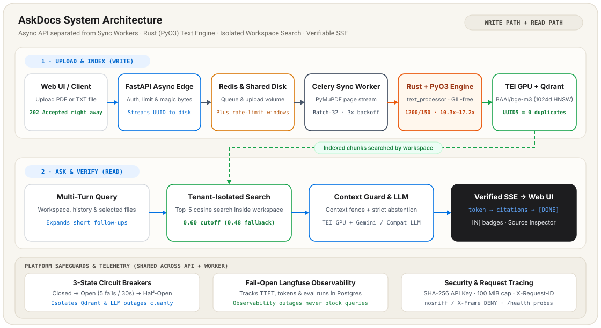

<div align="center">

<br />


<br />
<br />

**Dokümanlarınızı izole workspace'lere yükleyin, doğal dille sorular sorun ve üretilen her yanıtı birebir kaynak sayfasıyla doğrulayın.**

<p>
  <a href="#neden-askdocs">Neden AskDocs</a> ·
  <a href="#canlı-arayüz">Canlı Arayüz</a> ·
  <a href="#mimari-ve-tech-stack">Mimari</a> ·
  <a href="#tasarım-kararları">Tasarım Kararları</a> ·
  <a href="#benchmark-ve-ölçümler">Benchmark</a> ·
  <a href="#hızlı-kurulum">Kurulum</a> ·
  <a href="#api-referansı">API</a> ·
  <a href="README.md">English</a>
</p>

<p>
  <sub>
    <code>Python 3.11+</code> ·
    <code>Rust (PyO3)</code> ·
    <code>FastAPI</code> ·
    <code>Celery &amp; Redis</code> ·
    <code>Qdrant</code> ·
    <code>Gemini / OpenAI-Compat</code> ·
    <code>Langfuse</code> ·
    <code>169 Tests (163 Py + 6 Rust)</code> ·
    <code>%88.6 Branch Cov</code>
  </sub>
</p>

</div>

---

## Neden AskDocs?

Belgelerle sohbet eden bir sistem kurmak, yalnızca bir vector DB'nin önüne LLM bağlamaktan ibaret değildir. Büyük bir PDF yüklendiğinde API sunucusu sayfaları parse edip embedding üretmeye çalışırken diğer tüm istekleri kilitleyebilir. Farklı projelerin dokümanları aynı koleksiyonda karışabilir, geçici ağ hatalarındaki retry'lar Qdrant'ta duplicate vektörler üretebilir ve kullanıcı ekrandaki cevabın belgenin hangi sayfasından geldiğini göremez.

**AskDocs**, opak framework wrapper'ları yerine her katmanı şeffaf, hızlı ve öngörülebilir bir RAG platformu olarak sıfırdan geliştirildi.

### Öne Çıkan Özellikler

* **Tenant Workspace İzolasyonu ve Document Scoping:** Her belge ve sorgu ayrı bir `tenant` workspace'ine izole edilir; dilerseniz sol panelden belirli PDF'leri seçip aramayı yalnızca seçtiğiniz belgelerle daraltabilirsiniz.
* **Non-Blocking Arka Plan İndeksleme:** Upload isteği dosya doğrulamasını yapıp anında `202 Accepted` döner; PDF parsing, temizleme, chunking ve batch embedding üretimi arka plandaki Celery worker'larına devredilir.
* **Inline Citation'lar ve Source Inspector:** Yanıtlar SSE ile canlı gelirken her iddia tıklanabilir `[1]`, `[2]` badge'leri taşır. Bir badge'e tıklandığında sağdan açılan Source Inspector sizi doğrudan ilgili sayfaya, similarity score'una ve highlight edilmiş pasaja götürür.
* **Follow-Up Zekâsı ve Guardrail'ler:** Kısa takip sorularını önceki sohbet bağlamından çözer, belge içindeki `<context>` prompt-injection etiketlerini nötralize eder ve kanıt yoksa bilgi uydurmadan reddeder (`abstention`).
* **Resilience ve OpenAI-Compatible Esneklik:** Async ve sync Circuit Breaker'lar Qdrant veya LLM kesintilerini izole eder, Redis Rate Limiter ve Langfuse observability'si kesintilerde `fail-open` çalışır; `.env` üzerinden Gemini veya herhangi bir OpenAI-compatible API kolayca bağlanır.

---

## Canlı Arayüz

Aşağıdaki üç adımda arXiv'den alınan altı retrieval makalesinin (`REALM`, `DPR`, `FiD`, `HyDE`, `Self-RAG` ve `CRAG`) diğer workspace'lerden tamamen yalıtılmış **`rag-research`** alanındaki canlı kullanımını görebilirsiniz.

### `#1` / Workspace Seçimi ve Document Scoping

Sol alttan `tenant` workspace'leri arasında geçiş yapın, çoklu PDF veya düz metin yükleyin ve yalnızca `crag_2401_15884.pdf` ile `selfrag_2310_11511.pdf` dosyalarını işaretleyerek aramayı bu iki kaynakla sınırlandırın.

<div align="center">
  
</div>

### `#2` / Grounded Streaming ve Inline Citation'lar

Seçili İngilizce makaleleri kıyaslayan Türkçe bir soru sorduğunuzda yanıt yapılandırılmış Markdown formatında stream edilir. Her iddia tıklanabilir citation pill'leri, ham etiketleri temizleyen kopyalama butonu, bağlamsal follow-up önerisi (`Evet, öğrenmek isterim →`) ve sayfa/benzerlik kartlarıyla sunulur.

<div align="center">
  
</div>

### `#3` / Source Inspector ile Doğrulama

İlk citation badge'ine (`[1]`) tıkladığınızda sağdan açılan Cupertino Source Inspector paneli, sizi doğrudan `crag_2401_15884.pdf` belgesinin 2. sayfasına, `%78` match skoruna ve vurgulanmış (`CRAG`, `Self-RAG`) kaynak pasajlara götürür.

<div align="center">
  
</div>

---

## Mimari ve Tech Stack

<div align="center">
  
</div>

Sistem ağır belge işleme yükünü (**Yazma Akışı**) canlı sohbetten (**Okuma Akışı**) tamamen ayırır:

* **1. Yükleme ve İndeksleme (Write Path):**
  `PDF Yükleme` → `FastAPI (202 Accepted)` → `Celery Worker` → `PyMuPDF + Rust Parçalama` → `Qdrant Vektör Kaydı`
  Kullanıcı büyük bir PDF yüklediğinde API beklemez; doğrulamayı yapıp işi anında arka plana devreder. Worker sayfaları stream ederek okur, **Rust** motoruyla metni temizleyip anlamlı parçalara böler (`1200` karakter / `150` çakışma) ve vektörleri Qdrant'a kaydeder.

* **2. Soru Sorma ve Canlı Yanıt (Read Path):**
  `Soru` → `Qdrant Benzerlik Araması` → `Güvenlik ve Bağlam Filtresi` → `SSE Canlı Yanıt + Kaynak Kartları`
  Kısa takip soruları önceki sohbet bağlamından çözülür; yalnızca aktif çalışma alanındaki en alakalı 5 parça (`0.70` eşiği) getirilir. Kaynakta kanıt yoksa model uydurmaz; varsa tıklanabilir `[1]`, `[2]` rozetleriyle yanıtı kelime kelime tarayıcıya akıtır.

### Tech Stack Özeti

| Katman | Tercih | Projedeki Rolü |
| :--- | :--- | :--- |
| **API & Web Arayüzü** | FastAPI + Vanilla JS | Asenkron REST/SSE akışı, SHA-256 anahtar doğrulama ve çerçevesiz Cupertino arayüzü |
| **Kuyruk & Worker** | Celery + Redis | Ağır PDF/embedding işlerini API'den ayırır ve hız limitlerini (Rate Limit) takip eder |
| **PDF & Metin Motoru** | PyMuPDF + Rust (`PyO3`) | Hızlı sayfa okuma ve GIL kilitlemeyen yerel Rust temizleme/parçalama motoru |
| **Vektör Veritabanı** | Qdrant | Çalışma alanı bazlı izole arama, belge filtreleme ve çift kaydı önleyen indeksleme |
| **LLM & Embedding** | Gemini (OpenAI-Compat) | Bağlantı havuzlu `gemini-3.5-flash-lite` üretimi ve `3072` boyutlu vektörleştirme |
| **İzleme (Observability)** | Langfuse + PostgreSQL | Arama skorları, yanıt hızı (TTFT) ve token kullanımının `fail-open` takibi |

---

## Tasarım Kararları

| Karşılaşılan Sorun | Uygulanan Çözüm | Pratik Kazanç |
| :--- | :--- | :--- |
| **Büyük PDF'lerin Python'ı kilitlemesi** | Metin temizleme ve parçalama katmanı **Rust (`PyO3`)** ile yazıldı | **16.6x** daha hızlı temizlik, **9.7x** daha hızlı parçalama ve **3.7x** daha düşük RAM |
| **Yükleme sırasında API'nin donması** | FastAPI tamamen asenkron tutuldu; indeksleme Celery worker'larına ayrıldı | Yüklemelerde anında `202 Accepted` yanıtı; sohbet trafiği hiç yavaşlamaz |
| **Ağ kopmalarında çift kayıt veya dosya sızıntısı** | Otomatik disk geri alımı (`rollback`) ve deterministik `UUID5` vektör kimlikleri | Yeniden denemelerde sıfır yetim dosya ve sıfır kopya vektör kaydı |
| **Tek kullanıcı veya dış servisin sistemi düşürmesi** | 3 durumlu **Circuit Breaker** ve atomik Redis hız sınırlama (`fail-open`) | Dış servis kesintilerinde hızlı koruma; Redis veya Langfuse dursa bile arama sürer |
| **LLM'in kaynak dışı bilgi uydurması** | Kalibre benzerlik eşiği (`0.70`), injection temizliği ve `[DONE]` akış doğrulaması | Tuzak sorularda **%100** doğru ret; yarım kalan yanıtlar sohbet geçmişini bozmaz |

---

## Benchmark ve Ölçümler

Aşağıdaki tüm sayılar repodaki tekrarlanabilir değerlendirme, CPU/bellek karşılaştırma ve yük testi script'lerinden doğrudan ölçülmüştür.

### 1. RAG Doğruluk ve Halüsinasyon Testi (`rag-research` · 6 PDF)

Sistemin aynı alandaki benzer belgeleri birbirine karıştırıp karıştırmadığını ölçmek için, `rag-research` çalışma alanındaki **6 akademik RAG makalesi (toplam 385 metin parçası)** üzerinde **24 soruluk** (18 İngilizce/Türkçe normal soru + 6 belgede cevabı olmayan tuzak soru) bir değerlendirme koşturuldu:

| Ölçüt | Sonuç | Ne Anlama Geliyor? |
| :--- | :---: | :--- |
| **Doğru Kaynağı Bulma (`Recall@5`)** | **`1.0000`** (`18 / 18`) | 6 rakip makaledeki her soruda doğru sayfa ilk 5 sonuç içinde bulundu |
| **İlk Sıra İsabeti (`MRR`)** | **`0.7824`** | Yoğun terim örtüşmesine rağmen doğru kaynak yüksek oranda üst sırada geldi |
| **Kaynağa Sadakat (`Faithfulness`)** | **`0.9729`** | Yanıtlardaki tüm `[1]`, `[2]` atıfları gerçek sayfalara dayandı; uydurma atıf çıkmadı |
| **İçerik Kapsamı (`Keyword Coverage`)** | **`0.9398`** | Türkçe ve İngilizce sorularda kritik kavram ve sayıların %94'ü yanıtlandı |
| **Tuzak Soruları Reddetme (`Abstention`)** | **`1.0000`** (`6 / 6`) | Belgede karşılığı olmayan 6 şaşırtmacalı sorunun tamamında model bilgi uydurmadı |

<div align="center">
  
</div>

<details>
<summary><strong>Benzerlik eşiği (0.30–0.75) kalibrasyon tablosunu aç</strong></summary>

Koşum: `eval-20261118-193027` · Çalışma Alanı: `rag-research` (6 PDF / 385 parça) · `gemini-3.5-flash-lite` + `gemini-embedding-001` · [`evals/latest_eval_report.json`](evals/latest_eval_report.json)

| Eşik Değeri | `Recall@5` | `MRR` | Ortalama Parça | Tuzak Gürültüsü (`NegNoise`) |
| :---: | :---: | :---: | :---: | :---: |
| `0.30` | `1.0000` | `0.7824` | `5.00` | `1.0000` |
| `0.40` | `1.0000` | `0.7824` | `5.00` | `1.0000` |
| `0.50` | `1.0000` | `0.7824` | `5.00` | `1.0000` |
| `0.60` | `1.0000` | `0.7824` | `5.00` | `0.8333` |
| `0.65` | `1.0000` | `0.7824` | `5.00` | `0.6667` |
| `0.70` (Varsayılan) | `1.0000` | `0.7824` | `5.00` | `0.6667` |
| **`0.75` (Önerilen)** | **`1.0000`** | **`0.7824`** | **`4.44` (-%11.2)** | **`0.1667` (-%83.3)** |

Yoğun akademik korpusta eşik değerini `0.75`'e çekmek doğru sayfa yakalama oranını (`1.0000`) hiç düşürmeden tuzak gürültüsünü **%83.3 azaltır** ve modele gönderilen token yükünü **%11.2** düşürür.

</details>

### 2. Rust (`PyO3`) Bize Ne Kazandırdı? (50 MB Metin Testi)

50 MB büyüklüğündeki (~50 milyon karakter) gürültülü metin bloğu üzerinde ağ ve LLM beklemelerinden bağımsız olarak saf Python ile Rust motoru ([`evals/text_processor_benchmark.json`](evals/text_processor_benchmark.json)) karşılaştırıldı:

| İşlem | Saf Python | Rust (`PyO3`) | Kazanım |
| :--- | :---: | :---: | :--- |
| **Metin Temizleme (`clean_text`)** | `4.89 sn` (`10.2 MB/sn`) | **`0.29 sn` (`170.0 MB/sn`)** | **16.6x daha hızlı** |
| **Metin Parçalama (`chunk_text` · 69 bin parça)** | `4.93 sn` (`10.1 MB/sn`) | **`0.51 sn` (`98.6 MB/sn`)** | **9.7x daha hızlı** |
| **Parçalama Bellek Zirvesi (Python Heap)** | `749.5 MB` | **`202.1 MB`** | **3.7x daha az RAM** |

* **Neden bu kadar fark etti?** Saf Python büyük metinleri temizlerken bellekte sürekli ara string kopyaları oluşturur ve diğer işlemleri kilitler (GIL).
* **Sıfır Kilitlenme, Birebir Çıktı:** Rust çekirdeği metni GIL dışında tek geçişte işleyip Python belleğini şişirmez; üstelik tüm parçalarda Python ile **%100 birebir aynı** çıktıyı üretir.
* **Temiz Dağıtım:** Çok aşamalı Docker build ile final imajda Rust derleyici yükü bırakmaz; derlenmiş modül yoksa otomatik olarak saf Python'a geçer.

### 3. Yük Testi ve PDF Okuma Hızı

20 eşzamanlı kullanıcıyla yapılan 30 saniyelik Locust yük testi (dış LLM gecikmesini ayırmak için mock AI ile) ve PyMuPDF sayfa okuma ölçümleri:

| Test | Kapsam | Sonuç | Özet |
| :--- | :--- | :--- | :--- |
| **Locust Yük Testi** | 8 endpoint, 1.260 istek | **`43.21 RPS` · %0.0 hata** | `p50=21 ms`, `p95=120 ms`, `p99=160 ms` |
| **Konteyner Bellek Kararlılığı** | 4 ana servis (`docker stats`) | **Peak `182.5 MiB` API / `297.8 MiB` Worker** | Yoğun yükte 0 OOM, 0 yeniden başlatma |
| **PyMuPDF PDF Okuma** | 100 sayfalık PDF akışı | **`172.9 ms` (`578 sayfa/sn`)** | 5 ölçüm medyan hızı |
| **Akıllı Parça Boyutu (`1200/150`)** | 5.33 MB örnek doküman | **6.167 parça** | `500/75` ayarına (18.500) göre **3x daha az** embedding maliyeti |

<details>
<summary><strong>Endpoint bazlı Locust latency ve Docker container RAM tablosunu aç</strong></summary>

Tam rapor: [`evals/load_test_report.json`](evals/load_test_report.json)

| Endpoint | Request | Hata | RPS | `p50` | `p95` | `p99` |
| :--- | :---: | :---: | :---: | :---: | :---: | :---: |
| `GET /api/v1/health` | `119` | `%0.0` | `4.08` | `13.0 ms` | `52.0 ms` | `110.0 ms` |
| `POST /api/v1/documents/upload` | `72` | `%0.0` | `2.47` | `34.0 ms` | `77.0 ms` | `130.0 ms` |
| `GET /api/v1/documents/status/{task_id}` | `145` | `%0.0` | `4.97` | `7.0 ms` | `26.0 ms` | `52.0 ms` |
| `GET /api/v1/documents` | `239` | `%0.0` | `8.20` | `13.0 ms` | `67.0 ms` | `77.0 ms` |
| `GET /api/v1/documents/tenants` | `128` | `%0.0` | `4.39` | `10.0 ms` | `30.0 ms` | `90.0 ms` |
| `POST /api/v1/query` | `291` | `%0.0` | `9.98` | `110.0 ms` | `150.0 ms` | `240.0 ms` |
| `POST /api/v1/query/stream` | `194` | `%0.0` | `6.65` | `60.0 ms` | `120.0 ms` | `140.0 ms` |
| `DELETE /api/v1/documents/{document_id}` | `72` | `%0.0` | `2.47` | `11.0 ms` | `25.0 ms` | `60.0 ms` |

| Container | Başlangıç RAM | Peak RAM | Bitiş RAM | Max CPU | OOM / Restart |
| :--- | :---: | :---: | :---: | :---: | :---: |
| `corerag-api` | `179.6 MiB` | **`182.5 MiB`** | `182.5 MiB` | `58.23%` | `0 / 0` |
| `corerag-worker` | `244.2 MiB` | **`297.8 MiB`** | `297.8 MiB` | `49.29%` | `0 / 0` |
| `corerag-qdrant` | `86.30 MiB` | **`97.82 MiB`** | `97.73 MiB` | `11.72%` | `0 / 0` |
| `corerag-redis` | `6.53 MiB` | **`9.11 MiB`** | `8.95 MiB` | `1.67%` | `0 / 0` |

</details>

---

## Hızlı Kurulum

### 1. Klonlama ve `.env` Ayarları

```bash
git clone https://github.com/DuranGZR/AskDocs.git
cd AskDocs
cp .env.example .env
```

`.env` içinde güçlü bir `API_KEY` ve OpenAI-compatible provider bilgilerinizi tanımlayın (`QDRANT_VECTOR_SIZE` seçilen embedding modelinin vektör boyutuyla eşleşmelidir; örneğin `gemini-embedding-001` için `3072`):

```env
API_KEY=guclu-bir-rastgele-api-anahtari
LLM_BASE_URL=https://generativelanguage.googleapis.com/v1beta/openai
LLM_API_KEY=saglayici-api-anahtariniz
LLM_MODEL=gemini-3.5-flash-lite
EMBEDDING_MODEL=gemini-embedding-001
QDRANT_VECTOR_SIZE=3072
```

*(OpenAI, vLLM veya başka bir OpenAI-compatible API kullanacaksanız `LLM_BASE_URL`, model adları ve `QDRANT_VECTOR_SIZE` değerlerini kendi sağlayıcınıza göre güncelleyebilirsiniz.)*

### 2. Docker Compose ile Başlatma

```bash
docker compose up --build
```

Container'lar ayağa kalktığında açılan servisler:
* **AskDocs Web UI:** [http://localhost:8000/](http://localhost:8000/)
* **OpenAPI / Swagger Docs:** [http://localhost:8000/docs](http://localhost:8000/docs)
* **Qdrant Dashboard:** [http://localhost:6333/dashboard](http://localhost:6333/dashboard)
* **Langfuse Observability UI:** [http://localhost:3000](http://localhost:3000)

<details>
<summary><strong>Image build etmeden lokal geliştirme (uv)</strong></summary>

```bash
uv sync --frozen
docker compose up -d redis qdrant postgres langfuse

# Terminal 1 — FastAPI API & Web UI
uv run uvicorn src.main:app --reload --port 8000

# Terminal 2 — Celery Prefork Worker
uv run celery -A src.tasks.celery_app worker --loglevel=info --concurrency=2
```

> **Windows IPv6 notu:** Docker Redis'i `127.0.0.1:6379` üzerinden bind ettiği için Windows üzerinde doğrudan çalıştırırken `localhost` yerine `127.0.0.1` (`REDIS_URL=redis://127.0.0.1:6379/0`) kullanın.

</details>

---

## API Referansı

`/api/v1/documents/*` ve `/api/v1/query*` altındaki tüm endpoint'ler `X-API-Key: <API_KEY>` (veya `Authorization: Bearer <API_KEY>`) header'ı gerektirir.

| Method & Path | Rate Limit | Açıklama |
| :--- | :---: | :--- |
| `GET /api/v1/health` | Public | Storage, Redis, Qdrant ve Circuit Breaker health probe'ları (`200` / `503`) |
| `POST /api/v1/documents/upload` | `5 / dk` | `tenant_id` ile multipart `.pdf` / `.txt` upload (`202 Accepted` + `task_id`, `document_id`) |
| `GET /api/v1/documents/status/{task_id}` | `120 / dk` | Celery task durumu (`PENDING`, `STARTED`, `RETRY`, `SUCCESS`, `FAILURE`) |
| `GET /api/v1/documents` | `120 / dk` | Aktif `tenant` içindeki indekslenmiş doküman ve chunk sayıları |
| `GET /api/v1/documents/tenants` | `120 / dk` | Qdrant facet'leri üzerinden mevcut `tenant` workspace'lerini listeleme |
| `DELETE /api/v1/documents/{document_id}` | `5 / dk` | İlgili dokümanın `tenant`-izole tüm vektörlerini silme |
| `POST /api/v1/query` | `20 / dk` | Citation destekli RAG sorgusu (`stream` parametresine göre JSON veya SSE) |
| `POST /api/v1/query/stream` | `20 / dk` | Chat history ve opsiyonel `document_ids` scoping destekli SSE streaming endpoint'i |

<details>
<summary><strong>Uçtan uca cURL örneği ve SSE frame formatı</strong></summary>

```bash
# 1. "acme-legal" workspace'ine PDF yükle
curl -s -X POST http://localhost:8000/api/v1/documents/upload \
  -H "X-API-Key: change-me-in-local-env" \
  -F "tenant_id=acme-legal" \
  -F "file=@sozlesme.pdf"

# 2. Background indexing durumunu sorgula
curl -s http://localhost:8000/api/v1/documents/status/<task_id> \
  -H "X-API-Key: change-me-in-local-env"

# 3. SSE üzerinden citation'lı yanıt stream et
curl -N -X POST http://localhost:8000/api/v1/query/stream \
  -H "X-API-Key: change-me-in-local-env" \
  -H "Content-Type: application/json" \
  -d '{
    "query": "Fesih bildirim süresi kaç gündür?",
    "tenant_id": "acme-legal",
    "history": []
  }'
```

`/api/v1/query/stream` tarafından gönderilen ham SSE frame çıktısı:

```text
event: token
data: {"event":"token","delta":"Fesih bildirim süresi 30 takvim günüdür [Source 1]."}

event: citations
data: {"event":"citations","query":"...","tenant_id":"acme-legal","citations":[{"index":1,"document_id":"...","filename":"sozlesme.pdf","page_number":4,"score":0.8421,"text":"..."}]}

event: done
data: [DONE]
```

</details>

---

## Quality Gates ve Proje Yapısı

CI pipeline ([`.github/workflows/ci.yml`](.github/workflows/ci.yml)) her push ve PR'da Rust güvenlik/kalite kontrollerini, Python format/lint, strict `mypy` type check, JS syntax kontrolü, `pytest-cov` (`163` Python + `6` Rust testi üzerinden `>= %85` branch coverage kapısı) ve multi-stage non-root Docker Buildx doğrulamasını otomatik çalıştırır:

```bash
# Rust kontrolleri (text_processor/ içinde)
cargo fmt --check
cargo clippy --all-targets -- -D warnings
cargo test

# Python & JS format, lint, static type check, syntax ve izole testler (163 Py + 6 Rust = 169 passing)
uv run ruff format --check .
uv run ruff check .
uv run mypy src tests scripts locustfile.py
node --check src/ui/app.js
uv run pytest -v --cov=src --cov-report=term-missing

# Live concurrency, 6-PDF RAG eval, Rust vs Python benchmark ve Locust load script'leri
uv run python scripts/test_queue_concurrency.py --count 10
uv run python scripts/evaluate_rag.py --score-threshold 0.70 --thresholds "0.30,0.40,0.50,0.60,0.65,0.70,0.75" --delay-seconds 5.0
uv run --no-sync python scripts/benchmark_text_processor.py --size-mb 50 --iterations 3
uv run python scripts/run_load_test.py --users 20 --spawn-rate 5 --duration 30s --with-mock-ai
```

<details>
<summary><strong>Proje dizin ağacı</strong></summary>

```text
AskDocs/
├── .github/workflows/ci.yml       # Rust, Ruff, Mypy, Pytest-cov (%85+ branch) & Docker CI
├── docs/images/                   # Hero SVG, mimari SVG, eval chart ve UI ekran görüntüleri
├── evals/
│   ├── golden_dataset.json        # 24 soruluk 6-PDF (rag-research) + adversarial trap eval seti
│   ├── latest_eval_report.json    # Son calibration raporu (Recall@5, MRR, Faithfulness)
│   ├── load_test_report.json      # 20 kullanıcılı Locust latency & Docker RAM raporu
│   ├── text_processor_benchmark.json # 50 MiB Rust vs. Python CPU & heap benchmark raporu
│   └── README.md                  # Hyperparameter kalibrasyon ve Rust benchmark notları
├── scripts/
│   ├── benchmark_text_processor.py # 50 MiB clean/chunk CPU & tracemalloc parite testi
│   ├── evaluate_rag.py            # Golden Dataset runner + threshold sweep + Langfuse loglama
│   ├── run_load_test.py           # Locust runner + docker stats memory profiler
│   └── test_queue_concurrency.py  # Concurrent upload & retry test script'i
├── src/
│   ├── api/                       # API-Key auth, Redis rate limit, DI ve v1 endpoint'leri
│   ├── core/                      # Config, Circuit Breaker, logging, middleware ve Langfuse
│   ├── evals/                     # Metric calculator'lar (Recall@K, MRR, Faithfulness, Locust)
│   ├── schemas/                   # Pydantic v2 request/response ve SSE schema'ları
│   ├── services/                  # ABC interface'leri, storage, PyMuPDF + Rust loader, Qdrant ve LLM
│   ├── tasks/                     # Celery app ve idempotent indexing worker task'ı
│   ├── ui/                        # Cupertino Light Web UI (HTML, CSS, vanilla JS)
│   └── main.py                    # FastAPI lifespan, güvenlik middleware'leri ve UI mount
├── text_processor/
│   ├── python/text_processor/     # Typed .pyi stub'ları ve Python wrapper modülü
│   ├── src/lib.rs                 # #![forbid(unsafe_code)] PyO3 cleaner & O(chunk_size) chunker
│   ├── Cargo.toml                 # abi3-py311 release/dev-opt crate yapılandırması
│   └── pyproject.toml             # Maturin PEP 517 build yapılandırması
├── tests/                         # 163 izole Python unit/integration + 6 Rust testi
├── Dockerfile                     # 3-stage Rust wheel + Python builder -> non-root UID 10001 runtime
├── docker-compose.yml             # API, Celery Worker, Redis, Qdrant, Postgres, Langfuse
├── locustfile.py                  # Upload, poll, query, stream, delete Locust load senaryosu
└── pyproject.toml                 # Dependencies, uv lock ve Ruff/Mypy/Pytest/Coverage ayarları
```

</details>
