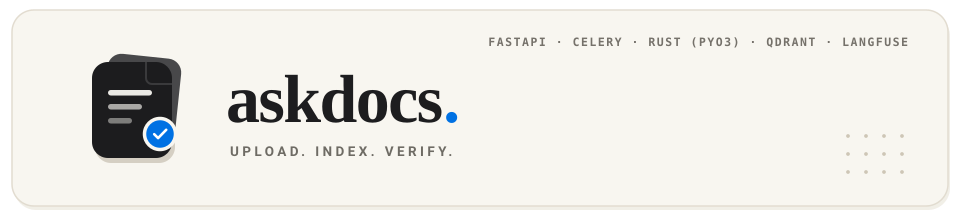
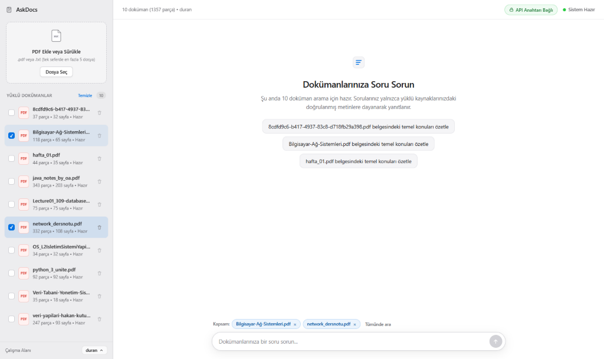
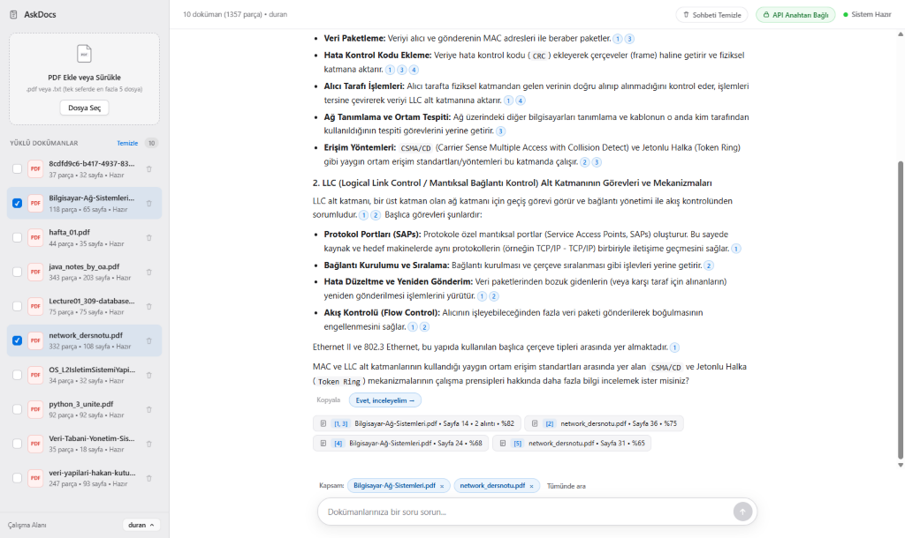
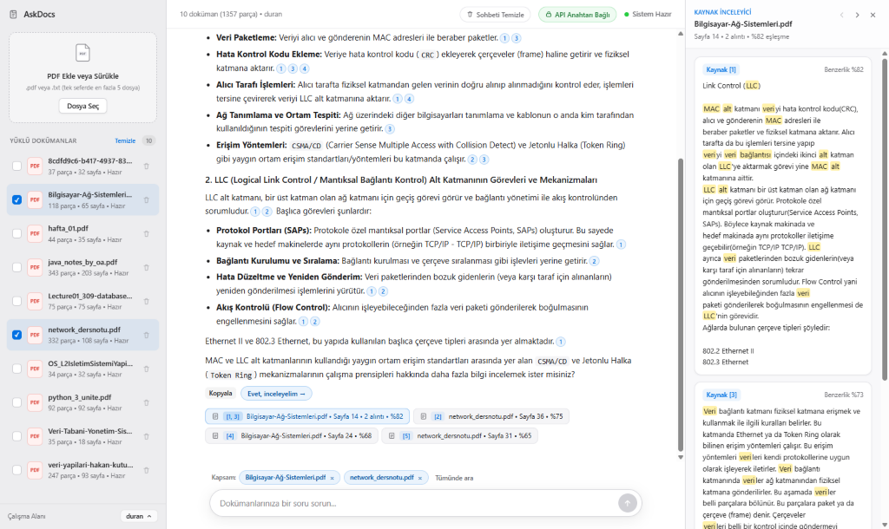
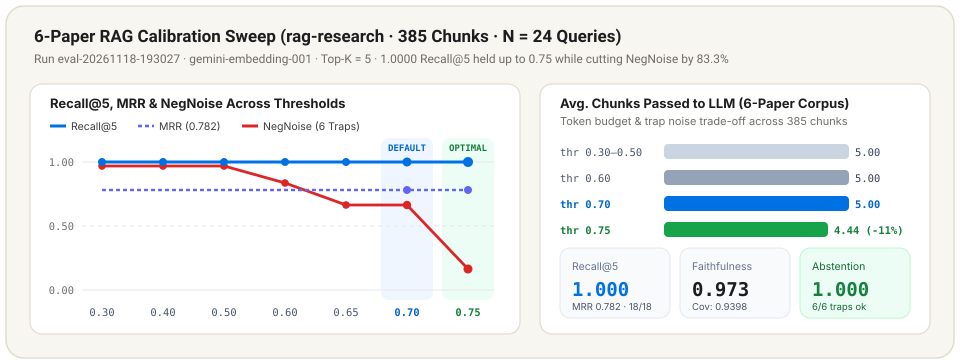

<div align="center">

<br />



<br />
<br />

**Dokümanlarınızı izole workspace'lere yükleyin, doğal dille sorular sorun ve üretilen her yanıtı birebir kaynak sayfasıyla doğrulayın.**

<p>
  <a href="#neden-askdocs">Neden AskDocs</a> ·
  <a href="#canlı-arayüz">Canlı Arayüz</a> ·
  <a href="#mimari-ve-tech-stack">Mimari</a> ·
  <a href="#tasarım-kararları">Tasarım Kararları</a> ·
  <a href="#benchmark-ve-ölçümler">Benchmark</a> ·
  <a href="#hızlı-kurulum">Kurulum</a> ·
  <a href="#api-referansı">API</a> ·
  <a href="README.md">English</a>
</p>

<p>
  <sub>
    <code>Python 3.11+</code> ·
    <code>Rust (PyO3)</code> ·
    <code>FastAPI</code> ·
    <code>Celery &amp; Redis</code> ·
    <code>Qdrant</code> ·
    <code>Gemini + Yerel TEI (BAAI/bge-m3)</code> ·
    <code>Langfuse</code> ·
    <code>179 Tests (173 Py + 6 Rust)</code> ·
    <code>%87.7 Branch Cov</code>
  </sub>
</p>

</div>

---

## Neden AskDocs?

Belgelerle sohbet eden bir sistem kurmak, yalnızca bir vector DB'nin önüne LLM bağlamaktan ibaret değildir. Büyük bir PDF yüklendiğinde API sunucusu sayfaları parse edip embedding üretmeye çalışırken diğer tüm istekleri kilitleyebilir. Farklı projelerin dokümanları aynı koleksiyonda karışabilir, geçici ağ hatalarındaki retry'lar Qdrant'ta duplicate vektörler üretebilir ve kullanıcı ekrandaki cevabın belgenin hangi sayfasından geldiğini göremez.

**AskDocs**, opak framework wrapper'ları yerine her katmanı şeffaf, hızlı ve öngörülebilir bir RAG platformu olarak sıfırdan geliştirildi.

### Öne Çıkan Özellikler

* **Tenant Workspace İzolasyonu ve Document Scoping:** Her belge ve sorgu ayrı bir `tenant` workspace'ine izole edilir; dilerseniz sol panelden belirli PDF'leri seçip aramayı yalnızca seçtiğiniz belgelerle daraltabilirsiniz.
* **Non-Blocking Arka Plan İndeksleme:** Upload isteği dosya doğrulamasını yapıp anında `202 Accepted` döner; PDF parsing, temizleme, chunking ve batch embedding üretimi arka plandaki Celery worker'larına devredilir.
* **Inline Citation'lar ve Source Inspector:** Yanıtlar SSE ile canlı gelirken her iddia tıklanabilir `[1]`, `[2]` badge'leri taşır. Bir badge'e tıklandığında sağdan açılan Source Inspector sizi doğrudan ilgili sayfaya, similarity score'una ve highlight edilmiş pasaja götürür.
* **Follow-Up Zekâsı ve Guardrail'ler:** Kısa takip sorularını ve belge başlığı sürekliliğini önceki sohbet bağlamından çözer, prompt-sızdırma girişimlerini ve `<context>` injection etiketlerini yalıtır, ret yanıtlarında alakasız kartları gizler ve kanıt yoksa bilgi uydurmadan reddeder (`abstention`).
* **Resilience ve Hibrit Model Taşınabilirliği:** Async ve sync Circuit Breaker'lar Qdrant veya LLM kesintilerini izole eder, Redis Rate Limiter ve Langfuse observability'si kesintilerde `fail-open` çalışır; `EMBEDDING_BASE_URL` yerel GPU embedding'ini (`HuggingFace TEI` + `BAAI/bge-m3`) bulut Chat LLM'den (`gemini-3.5-flash-lite`) ayırır ve Qdrant vektör boyutu değiştiğinde koleksiyonu otomatik yeniden kurar.

---

## Canlı Arayüz

Aşağıdaki üç adımda Bilgisayar Ağları, Veritabanı Yönetim Sistemleri, İşletim Sistemleri, Python, Java OOP, Veri Yapıları ve Yapay Zekâ Okuryazarlığı derslerinden **10 üniversite PDF'i (`753` indekslenmiş sayfa, `1.357` parça)** barındıran izole **`duran`** çalışma alanındaki canlı kullanımı görebilirsiniz.

### `#1` / Workspace Seçimi ve Document Scoping

Sol alttan `tenant` workspace'leri arasında geçiş yapın, çoklu PDF veya düz metin yükleyin ve yalnızca `Bilgisayar-Ağ-Sistemleri.pdf` ile `network_dersnotu.pdf` dosyalarını işaretleyerek aramayı bu iki bilgisayar ağları kaynağıyla sınırlandırın.

<div align="center">
  
</div>

### `#2` / Grounded Streaming ve Inline Citation'lar

Seçili iki ağ ders notunu birlikte tarayan teknik bir soru sorduğunuzda yanıt yapılandırılmış Markdown formatında stream edilir. Her iddia tıklanabilir `[1]`, `[2]`, `[3]`, `[4]` badge'leri, ham etiketleri temizleyen `Kopyala` butonu, bağlamsal follow-up önerisi (`Evet, inceleyelim →`) ve her iki PDF'ten gelen sayfa/benzerlik kartlarıyla (`%82`, `%75`, `%68`, `%65`) sunulur.

<div align="center">
  
</div>

### `#3` / Source Inspector ile Doğrulama

İlk citation kartına (`[1, 3]`) tıkladığınızda sağdan açılan Cupertino Kaynak İnceleyici paneli, sizi doğrudan **`Bilgisayar-Ağ-Sistemleri.pdf` belgesinin 14. sayfasına** (`2` alıntı, **`%82`** ve **`%73`** eşleşme skoru) ve sarı vurgulanmış (`LLC`, `MAC`, `veri`, `bağlantısı`, `alt`) kaynak pasajlara götürür.

<div align="center">
  
</div>

---

## Mimari ve Tech Stack

<div align="center">
  
</div>

Sistem ağır belge işleme yükünü (**Yazma Akışı**) canlı sohbetten (**Okuma Akışı**) tamamen ayırır:

* **1. Yükleme ve İndeksleme (Write Path):**
  `PDF Yükleme` → `FastAPI (202 Accepted)` → `Celery Worker` → `PyMuPDF + Rust Parçalama` → `Yerel TEI GPU (BAAI/bge-m3)` → `Qdrant (1024-dim)`
  Kullanıcı büyük bir PDF yüklediğinde API beklemez; doğrulamayı yapıp işi anında arka plana devreder. Worker sayfaları stream ederek okur, **Rust (`PyO3`)** motoruyla metni temizleyip anlamlı parçalara böler (`1200` karakter / `150` çakışma), yerel GPU **HuggingFace TEI** sunucusunda kotasız `1024` boyutlu vektörler üretir (`1.357` parça `98.8 parça/sn` hızında) ve Qdrant'a kaydeder.

* **2. Soru Sorma ve Canlı Yanıt (Read Path):**
  `Soru` → `Yerel TEI Embedding` → `Qdrant Benzerlik Araması` → `Güvenlik ve Bağlam Filtresi` → `SSE Canlı Yanıt + Kaynak Kartları`
  Kısa takip soruları ve belge başlığı sürekliliği önceki sohbet bağlamından çözülür; TEI sorguyu yerelde (`p50 = 17.9 ms`) vektörleştirir ve aktif çalışma alanındaki en alakalı 5 parça (`0.60` birincil / `0.48` yedek eşik) getirilir. Kaynakta kanıt yoksa veya prompt sızdırma girişimi algılanırsa model uydurmaz ve sıfır kaynakla reddeder; kanıt varsa tıklanabilir `[1]`, `[2]` rozetleriyle yanıtı kelime kelime tarayıcıya akıtır.

### Tech Stack Özeti

| Katman | Tercih | Projedeki Rolü |
| :--- | :--- | :--- |
| **API & Web Arayüzü** | FastAPI + Vanilla JS | Asenkron REST/SSE akışı, SHA-256 anahtar doğrulama ve çerçevesiz Cupertino arayüzü |
| **Kuyruk & Worker** | Celery + Redis | Ağır PDF/embedding işlerini API'den ayırır ve hız limitlerini (Rate Limit) takip eder |
| **PDF & Metin Motoru** | PyMuPDF + Rust (`PyO3`) | Hızlı sayfa okuma ve GIL kilitlemeyen yerel Rust temizleme/parçalama motoru |
| **Vektör Veritabanı** | Qdrant | Çalışma alanı bazlı izole arama, belge filtreleme, otomatik boyut uyumu ve idempotent upsert |
| **Embedding (Yerel GPU)** | HuggingFace TEI (`BAAI/bge-m3`) | Kotasız `float16` CUDA çıkarımı (`1024` boyut, `8192` token penceresi, `corerag-tei`) |
| **Chat LLM (Bulut / Compat)** | Gemini (`gemini-3.5-flash-lite`) | Bağlantı havuzlu OpenAI-uyumlu SSE akışı (`LLM_BASE_URL`, `.env` üzerinden değiştirilebilir) |
| **İzleme (Observability)** | Langfuse + PostgreSQL | Arama skorları, yanıt hızı (TTFT) ve token kullanımının `fail-open` takibi |

---

## Tasarım Kararları

| Karşılaşılan Sorun | Uygulanan Çözüm | Pratik Kazanç |
| :--- | :--- | :--- |
| **Bulut embedding kotasının PDF yüklemelerini yavaşlatması** | `EMBEDDING_BASE_URL` ayrılarak embedding yerel GPU **HuggingFace TEI (`BAAI/bge-m3`)**'ye, Chat ise `LLM_BASE_URL`'e yönlendirildi | **Sıfır `429` embedding kotası**, `p50=17.9 ms` sorgu vektörleme, 10 PDF'lik tüm korpusta (`1.357` parça) **`13.7 sn`** toplu vektörleme (`98.8 parça/sn`, RTX 3050 Ti) ve **3x** daha az Qdrant vektör alanı (`1024` vs `3072`) |
| **Büyük PDF'lerin Python'ı kilitlemesi** | Metin temizleme ve parçalama katmanı **Rust (`PyO3`)** ile yazıldı | **17.2x** daha hızlı temizlik, **10.3x** daha hızlı parçalama ve **3.7x** daha düşük RAM |
| **Yükleme sırasında API'nin donması** | FastAPI tamamen asenkron tutuldu; indeksleme Celery worker'larına ayrıldı | Yüklemelerde anında `202 Accepted` yanıtı; yüksek eşzamanlılıkta dahi **`p50=14.0 ms`** yanıt |
| **Ağ kopmalarında çift kayıt veya dosya sızıntısı** | Otomatik disk geri alımı (`rollback`) ve deterministik `UUID5` vektör kimlikleri | Yeniden denemelerde sıfır yetim dosya ve sıfır kopya vektör kaydı |
| **Tek kullanıcı veya dış servisin sistemi düşürmesi** | 3 durumlu **Circuit Breaker** ve atomik Redis hız sınırlama (`fail-open`) | Dış servis kesintilerinde hızlı koruma; Redis veya Langfuse dursa bile arama sürer |
| **LLM'in kaynak dışı bilgi uydurması veya sızıntı** | Kalibre `0.60`/`0.48` eşikleri, `<context>` + prompt-extraction koruması ve `[DONE]` doğrulaması | Tuzak sorularda **%100** doğru ret ve `0.60` eşiğinde **`%0` tuzak gürültüsü**; rette alakasız kart yok |

---

## Benchmark ve Ölçümler

Aşağıdaki tüm sayılar **`duran` çalışma alanındaki 10 PDF (`753` indekslenmiş sayfa, `1.357` parça)** ve repodaki tekrarlanabilir değerlendirme, GPU, CPU/bellek karşılaştırma ve yük testi script'lerinden doğrudan ölçülmüştür.

### 1. RAG Doğruluk ve Halüsinasyon Testi (`duran` · 10 PDF · 1.357 Parça)

Sistemin birbiriyle konu bakımından örtüşen çoklu ders dokümanlarını (2 Bilgisayar Ağları, 2 Veritabanı, 2 Python ders notu + Java, İşletim Sistemleri, Veri Yapıları ve Yapay Zekâ) birbirine karıştırıp karıştırmadığını ölçmek için **`duran`** çalışma alanında **30 soruluk** (`24` Türkçe/İngilizce pozitif soru + `6` belgede karşılığı olmayan / şaşırtmacalı near-miss tuzak soru) bir değerlendirme koşturuldu:

| Ölçüt | Sonuç | Ne Anlama Geliyor? |
| :--- | :---: | :--- |
| **Doğru Kaynağı Bulma (`Recall@5`)** | **`1.0000`** (`24 / 24`) | 10 ders kitabındaki tüm pozitif sorularda beklenen sayfa ilk 5 sonuç içinde bulundu |
| **İlk Sıra İsabeti (`MRR`)** | **`0.9097`** | Yoğun terim örtüşmesine rağmen soruların 20/24'ünde doğru sayfa tam 1. sırada geldi |
| **Kaynağa Sadakat (`Faithfulness`)** | **`0.9867`** | Yanıtlardaki tüm `[Source N]` atıfları gerçek sayfalara dayandı; uydurma atıf çıkmadı |
| **İçerik Kapsamı (`Keyword Coverage`)** | **`0.9722`** | Türkçe ve İngilizce sorularda kritik teknik terim ve sayıların %97.2'si yanıtlandı |
| **Tuzak Soruları Reddetme (`Abstention`)** | **`1.0000`** (`6 / 6`) | Genel ve adversarial tüm tuzaklarda model bilgi uydurmadan temiz ret verdi |

<div align="center">
  
</div>

<details>
<summary><strong>Benzerlik eşiği (0.30–0.70) kalibrasyon tablosunu aç (duran · 10 PDF)</strong></summary>

Koşum: `eval-20261120-203718` · Çalışma Alanı: `duran` (`10` PDF / `753` sayfa / `1.357` parça) · `gemini-3.5-flash-lite` + `BAAI/bge-m3` · [`evals/latest_eval_report.json`](evals/latest_eval_report.json)

| Eşik Değeri | `Recall@5` | `MRR` | Ortalama Parça | Tuzak Gürültüsü (`NegNoise`) |
| :---: | :---: | :---: | :---: | :---: |
| `0.30` | `1.0000` | `0.9097` | `5.00` | `1.0000` |
| `0.40` | `1.0000` | `0.9097` | `5.00` | `0.8333` |
| `0.48` (Yedek Eşik) | `1.0000` | `0.9097` | `5.00` | `0.6667` |
| `0.55` | `1.0000` | `0.9097` | `4.62` (`-%7.6`) | `0.1667` |
| **`0.60` (Canlı / Önerilen)** | **`1.0000`** | **`0.9097`** | **`3.29` (-%34.2)** | **`0.0000` (-%100.0)** |
| `0.65` | `0.7917` | `0.7708` | `1.58` | `0.0000` |
| `0.70` | `0.6250` | `0.6042` | `0.92` | `0.0000` |

`BAAI/bge-m3` vektör uzayında `0.60` eşiği tam Pareto optimumundadır: `Recall@5` (`1.0000`) ve `MRR` (`0.9097`) değerlerini hiç düşürmeden **6/6 tuzak sorusunun tamamında gürültüyü sıfırlar (`0.0000`)** ve modele gönderilen parça/token yükünü **%34.2** azaltır (`5.00 -> 3.29`). Eşik `0.65`'e çıkarıldığında ise `Recall@5` değeri `0.7917`'ye düşer.

</details>

### 2. Rust (`PyO3`) Bize Ne Kazandırdı? (50 MiB Metin Testi)

50.00 MiB büyüklüğündeki (`49,585,446` karakter) gürültülü metin bloğu üzerinde ağ ve LLM beklemelerinden bağımsız olarak saf Python ile Rust motoru ([`evals/text_processor_benchmark.json`](evals/text_processor_benchmark.json)) karşılaştırıldı:

| İşlem | Saf Python | Rust (`PyO3` v0.1.0) | Kazanım |
| :--- | :---: | :---: | :--- |
| **Metin Temizleme (`clean_text`)** | `4.40 sn` (`11.36 MiB/sn`) | **`0.26 sn` (`195.83 MiB/sn`)** | **17.23x daha hızlı** |
| **Metin Parçalama (`chunk_text` · 69.349 parça)** | `4.34 sn` (`11.53 MiB/sn`) | **`0.42 sn` (`118.87 MiB/sn`)** | **10.31x daha hızlı** |
| **Parçalama Bellek Zirvesi (Python Heap)** | `749.51 MiB` | **`202.12 MiB`** | **3.71x daha az RAM** |

* **Neden bu kadar fark etti?** Saf Python büyük metinleri temizlerken bellekte sürekli ara string kopyaları oluşturur ve diğer işlemleri kilitler (GIL).
* **Sıfır Kilitlenme, Birebir Çıktı:** Rust çekirdeği metni GIL dışında tek geçişte işleyip Python belleğini şişirmez; üstelik tüm parçalarda Python ile **%100 birebir aynı** çıktıyı üretir.
* **Temiz Dağıtım:** Çok aşamalı Docker build ile final imajda Rust derleyici yükü bırakmaz; derlenmiş modül yoksa otomatik olarak saf Python'a geçer.

### 3. Yük Testi, Yerel TEI GPU ve PDF Okuma Hızı

20 eşzamanlı kullanıcıyla yapılan 30 saniyelik Locust yük testi (orkestrasyon yükünü ayırmak için mock AI ile), `duran` 10-PDF korpusu üzerinde canlı TEI GPU hızı ve PyMuPDF sayfa okuma ölçümleri:

| Test | Kapsam | Sonuç | Özet |
| :--- | :--- | :--- | :--- |
| **Locust Yük Testi** | 8 endpoint, `1.297` istek | **`44.45 RPS` · %0.0 hata** | `p50=14.0 ms`, `p95=130.0 ms`, `p99=170.0 ms` |
| **Konteyner Bellek Kararlılığı** | 4 ana servis (`docker stats`) | **Peak `162.5 MiB` API / `286.5 MiB` Worker** | 0 OOM, 0 restart (`782.9 MiB` TEI GPU servisi) |
| **Yerel TEI Tekil Sorgu Hızı** | 30 `BAAI/bge-m3` sorgusu | **`p50=17.90 ms` (`p95=21.03 ms`)** | Bulut API gecikmesi ve kota limiti olmadan |
| **Yerel TEI Toplu Vektörleme** | Tüm `duran` 10 PDF (`1.357` parça) | **`13.73 sn` (`98.8 parça/sn`)** | 753 sayfalık korpusun tamamı 13.7 sn (`batch=32`) |
| **PyMuPDF PDF Okuma** | `duran` metinli 100 sayfalık PDF | **`37.04 ms` (`2.700 sayfa/sn`)** | 5 ölçüm medyan hızı (`iter_document_pages`) |
| **Akıllı Parça Boyutu (`1200/150`)** | Gerçek `duran` 10 PDF (`1.14 MB`) | **`1.027` parça** | `500/75` ayarına (`2.658`) göre **2.59x daha az** embedding |

<details>
<summary><strong>Endpoint bazlı Locust latency ve Docker container RAM tablosunu aç</strong></summary>

Tam rapor: [`evals/load_test_report.json`](evals/load_test_report.json)

| Endpoint | Request | Hata | RPS | `p50` | `p95` | `p99` |
| :--- | :---: | :---: | :---: | :---: | :---: | :---: |
| `GET /api/v1/health` | `130` | `%0.0` | `4.46` | `10.0 ms` | `28.0 ms` | `62.0 ms` |
| `POST /api/v1/documents/upload` | `77` | `%0.0` | `2.64` | `52.0 ms` | `76.0 ms` | `92.0 ms` |
| `GET /api/v1/documents/status/{task_id}` | `154` | `%0.0` | `5.28` | `6.0 ms` | `19.0 ms` | `34.0 ms` |
| `GET /api/v1/documents` | `267` | `%0.0` | `9.15` | `9.0 ms` | `20.0 ms` | `37.0 ms` |
| `GET /api/v1/documents/tenants` | `131` | `%0.0` | `4.49` | `8.0 ms` | `24.0 ms` | `59.0 ms` |
| `POST /api/v1/query` | `286` | `%0.0` | `9.80` | `110.0 ms` | `170.0 ms` | `190.0 ms` |
| `POST /api/v1/query/stream` | `175` | `%0.0` | `6.00` | `64.0 ms` | `120.0 ms` | `140.0 ms` |
| `DELETE /api/v1/documents/{document_id}` | `77` | `%0.0` | `2.64` | `9.0 ms` | `23.0 ms` | `29.0 ms` |

| Container | Başlangıç RAM | Peak RAM | Bitiş RAM | Max CPU | OOM / Restart |
| :--- | :---: | :---: | :---: | :---: | :---: |
| `corerag-api` | `160.70 MiB` | **`162.50 MiB`** | `161.10 MiB` | `37.03%` | `0 / 0` |
| `corerag-worker` | `226.70 MiB` | **`286.50 MiB`** | `282.00 MiB` | `26.69%` | `0 / 0` |
| `corerag-qdrant` | `147.90 MiB` | **`150.90 MiB`** | `131.80 MiB` | `7.32%` | `0 / 0` |
| `corerag-redis` | `10.18 MiB` | **`12.48 MiB`** | `12.36 MiB` | `1.69%` | `0 / 0` |

</details>

---

## Hızlı Kurulum

### 1. Klonlama ve `.env` Ayarları

```bash
git clone https://github.com/DuranGZR/AskDocs.git
cd AskDocs
cp .env.example .env
```

`.env` içinde güçlü bir `API_KEY` ile hibrit Chat LLM + yerel TEI Embedding ayarlarınızı tanımlayın (`QDRANT_VECTOR_SIZE` seçilen embedding modelinin vektör boyutuyla eşleşmelidir; `BAAI/bge-m3` için `1024`):

```env
API_KEY=guclu-bir-rastgele-api-anahtari
LLM_BASE_URL=https://generativelanguage.googleapis.com/v1beta/openai
LLM_API_KEY=saglayici-api-anahtariniz
LLM_MODEL=gemini-3.5-flash-lite
EMBEDDING_BASE_URL=http://localhost:8081/v1
EMBEDDING_API_KEY=local-tei
EMBEDDING_MODEL=BAAI/bge-m3
QDRANT_VECTOR_SIZE=1024
RAG_SCORE_THRESHOLD=0.60
RAG_FALLBACK_SCORE_THRESHOLD=0.48
```

*(Hem chat hem embedding için tek bir bulut/OpenAI-compatible sağlayıcı kullanmak isterseniz `EMBEDDING_BASE_URL=` ve `EMBEDDING_API_KEY=` alanlarını boş bırakın — sistem otomatik `LLM_BASE_URL`/`LLM_API_KEY` ayarlarına döner — ve `QDRANT_VECTOR_SIZE` değerini modelinize göre güncelleyin; örn. `gemini-embedding-001` için `3072`. Not: `corerag-tei` GPU servisini Docker'da çalıştırmak için NVIDIA GPU ve NVIDIA Container Toolkit etkin olmalıdır.)*

### 2. Docker Compose ile Başlatma

```bash
docker compose up --build
```

Container'lar ayağa kalktığında açılan servisler:
* **AskDocs Web UI:** [http://localhost:8000/](http://localhost:8000/)
* **OpenAPI / Swagger Docs:** [http://localhost:8000/docs](http://localhost:8000/docs)
* **Yerel TEI Embedding Sunucusu:** [http://localhost:8081/health](http://localhost:8081/health)
* **Qdrant Dashboard:** [http://localhost:6333/dashboard](http://localhost:6333/dashboard)
* **Langfuse Observability UI:** [http://localhost:3000](http://localhost:3000)

<details>
<summary><strong>Image build etmeden lokal geliştirme (uv)</strong></summary>

```bash
uv sync --frozen
docker compose up -d redis qdrant postgres langfuse tei

# Terminal 1 — FastAPI API & Web UI
uv run uvicorn src.main:app --reload --port 8000

# Terminal 2 — Celery Prefork Worker
uv run celery -A src.tasks.celery_app worker --loglevel=info --concurrency=2
```

> **Windows IPv6 notu:** Docker Redis'i `127.0.0.1:6379` üzerinden bind ettiği için Windows üzerinde doğrudan çalıştırırken `localhost` yerine `127.0.0.1` (`REDIS_URL=redis://127.0.0.1:6379/0`) kullanın.

</details>

---

## API Referansı

`/api/v1/documents/*` ve `/api/v1/query*` altındaki tüm endpoint'ler `X-API-Key: <API_KEY>` (veya `Authorization: Bearer <API_KEY>`) header'ı gerektirir.

| Method & Path | Rate Limit | Açıklama |
| :--- | :---: | :--- |
| `GET /api/v1/health` | Public | Storage, Redis, Qdrant ve Circuit Breaker health probe'ları (`200` / `503`) |
| `POST /api/v1/documents/upload` | `5 / dk` | `tenant_id` ile multipart `.pdf` / `.txt` upload (`202 Accepted` + `task_id`, `document_id`) |
| `GET /api/v1/documents/status/{task_id}` | `120 / dk` | Celery task durumu (`PENDING`, `STARTED`, `RETRY`, `SUCCESS`, `FAILURE`) |
| `GET /api/v1/documents` | `120 / dk` | Aktif `tenant` içindeki indekslenmiş doküman ve chunk sayıları |
| `GET /api/v1/documents/tenants` | `120 / dk` | Qdrant facet'leri üzerinden mevcut `tenant` workspace'lerini listeleme |
| `DELETE /api/v1/documents/{document_id}` | `5 / dk` | İlgili dokümanın `tenant`-izole tüm vektörlerini silme |
| `POST /api/v1/query` | `20 / dk` | Citation destekli RAG sorgusu (`stream` parametresine göre JSON veya SSE) |
| `POST /api/v1/query/stream` | `20 / dk` | Chat history ve opsiyonel `document_ids` scoping destekli SSE streaming endpoint'i |

<details>
<summary><strong>Uçtan uca cURL örneği ve SSE frame formatı</strong></summary>

```bash
# 1. "acme-legal" workspace'ine PDF yükle
curl -s -X POST http://localhost:8000/api/v1/documents/upload \
  -H "X-API-Key: change-me-in-local-env" \
  -F "tenant_id=acme-legal" \
  -F "file=@sozlesme.pdf"

# 2. Background indexing durumunu sorgula
curl -s http://localhost:8000/api/v1/documents/status/<task_id> \
  -H "X-API-Key: change-me-in-local-env"

# 3. SSE üzerinden citation'lı yanıt stream et
curl -N -X POST http://localhost:8000/api/v1/query/stream \
  -H "X-API-Key: change-me-in-local-env" \
  -H "Content-Type: application/json" \
  -d '{
    "query": "Fesih bildirim süresi kaç gündür?",
    "tenant_id": "acme-legal",
    "history": []
  }'
```

`/api/v1/query/stream` tarafından gönderilen ham SSE frame çıktısı:

```text
event: token
data: {"event":"token","delta":"Fesih bildirim süresi 30 takvim günüdür [Source 1]."}

event: citations
data: {"event":"citations","query":"...","tenant_id":"acme-legal","citations":[{"index":1,"document_id":"...","filename":"sozlesme.pdf","page_number":4,"score":0.8421,"text":"..."}]}

event: done
data: [DONE]
```

</details>

---

## Quality Gates ve Proje Yapısı

CI pipeline ([`.github/workflows/ci.yml`](.github/workflows/ci.yml)) her push ve PR'da Rust güvenlik/kalite kontrollerini, Python format/lint, strict `mypy` type check, JS syntax kontrolü, `pytest-cov` (`173` Python + `6` Rust testi üzerinden `>= %85` branch coverage kapısı, güncel `%87.7`) ve multi-stage non-root Docker Buildx doğrulamasını otomatik çalıştırır:

```bash
# Rust kontrolleri (text_processor/ içinde)
cargo fmt --check
cargo clippy --all-targets -- -D warnings
cargo test

# Python & JS format, lint, static type check, syntax ve izole testler (173 Py + 6 Rust = 179 test)
uv run ruff format --check .
uv run ruff check .
uv run mypy src tests scripts locustfile.py
node --check src/ui/app.js
uv run pytest -v --cov=src --cov-report=term-missing

# Live concurrency, 10-PDF RAG eval, Rust vs Python benchmark ve Locust load script'leri
uv run python scripts/test_queue_concurrency.py --count 10
uv run python scripts/evaluate_rag.py --dataset evals/golden_dataset.json --output evals/latest_eval_report.json --score-threshold 0.60 --thresholds "0.30,0.40,0.48,0.55,0.60,0.65,0.70" --delay-seconds 4.5
uv run --no-sync python scripts/benchmark_text_processor.py --size-mb 50 --iterations 3 --output evals/text_processor_benchmark.json
uv run python scripts/run_load_test.py --users 20 --spawn-rate 5 --duration 30s --with-mock-ai --output evals/load_test_report.json
```

<details>
<summary><strong>Proje dizin ağacı</strong></summary>

```text
AskDocs/
├── .github/workflows/ci.yml       # Rust, Ruff, Mypy, Pytest-cov (%85+ branch) & Docker CI
├── docs/images/                   # Hero SVG, mimari SVG, eval chart ve UI ekran görüntüleri
├── evals/
│   ├── golden_dataset.json        # 30 soruluk 10-PDF (duran) + adversarial trap eval seti (v4.0)
│   ├── latest_eval_report.json    # Son calibration raporu (Recall@5, MRR, Faithfulness)
│   ├── load_test_report.json      # 20 kullanıcılı Locust latency & Docker RAM raporu
│   ├── text_processor_benchmark.json # 50 MiB Rust vs. Python CPU & heap benchmark raporu
│   └── README.md                  # Hyperparameter kalibrasyon, GPU ve Rust benchmark notları
├── scripts/
│   ├── benchmark_text_processor.py # 50 MiB clean/chunk CPU & tracemalloc parite testi
│   ├── evaluate_rag.py            # Golden Dataset runner + threshold sweep + Langfuse loglama
│   ├── run_load_test.py           # Locust runner + docker stats memory profiler
│   └── test_queue_concurrency.py  # Concurrent upload & retry test script'i
├── src/
│   ├── api/                       # API-Key auth, Redis rate limit, DI ve v1 endpoint'leri
│   ├── core/                      # Config, Circuit Breaker, logging, middleware ve Langfuse
│   ├── evals/                     # Metric calculator'lar (Recall@K, MRR, Faithfulness, Locust)
│   ├── schemas/                   # Pydantic v2 request/response ve SSE schema'ları
│   ├── services/                  # ABC interface'leri, storage, PyMuPDF + Rust loader, Qdrant ve LLM
│   ├── tasks/                     # Celery app ve idempotent indexing worker task'ı
│   ├── ui/                        # Cupertino Light Web UI (HTML, CSS, vanilla JS)
│   └── main.py                    # FastAPI lifespan, güvenlik middleware'leri ve UI mount
├── text_processor/
│   ├── python/text_processor/     # Typed .pyi stub'ları ve Python wrapper modülü
│   ├── src/lib.rs                 # #![forbid(unsafe_code)] PyO3 cleaner & O(chunk_size) chunker
│   ├── Cargo.toml                 # abi3-py311 release/dev-opt crate yapılandırması
│   └── pyproject.toml             # Maturin PEP 517 build yapılandırması
├── tests/                         # 173 izole Python unit/integration + 6 Rust testi
├── Dockerfile                     # 3-stage Rust wheel + Python builder -> non-root UID 10001 runtime
├── docker-compose.yml             # API, Celery Worker, TEI (GPU), Redis, Qdrant, Postgres, Langfuse
├── locustfile.py                  # Upload, poll, query, stream, delete Locust load senaryosu
└── pyproject.toml                 # Dependencies, uv lock & Ruff/Mypy/Pytest/Coverage ayarları
```

</details>
